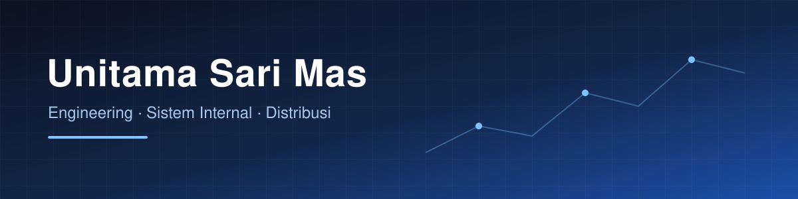

### Membangun sistem internal yang andal untuk operasional USM

---

## 🧭 Tentang kami

Tim engineering PT. Unitama Sarimas (USM) membangun dan merawat sistem internal: aplikasi bisnis, API, ERP, hingga infrastruktur server dan database yang menopangnya.

> ✏️ _Sesuaikan paragraf ini dengan deskripsi resmi organisasi._

## 🛠️ Tech stack

## 📡 Status repo (real-time)

<!--MONITOR:START-->
**26** repo · **8** aktif · **489** commit (30 hari) · **0** issue terbuka · **4** PR terbuka

| Repo | Bahasa | Commit 30h | Issue | PR | CI | Status |
|---|---|---:|---:|---:|:---:|---|
| 🔒 Repo privat #3 | — | 190 | 0 | 0 | ➖ | 🟢 Aktif |
| 🔒 Repo privat #5 | — | 161 | 0 | 4 | ➖ | 🟢 Aktif |
| 🔒 Repo privat #8 | — | 128 | 0 | 0 | ➖ | 🟢 Aktif |
| 🔒 Repo privat #7 | — | 4 | 0 | 0 | ➖ | 🟢 Aktif |
| 🔒 Repo privat #2 | — | 3 | 0 | 0 | ➖ | 🟢 Aktif |
| 🔒 Repo privat #6 | — | 3 | 0 | 0 | ➖ | 🟢 Aktif |
| 🔒 Repo privat #1 | — | 0 | 0 | 0 | ➖ | 🟢 Aktif |
| 🔒 Repo privat #4 | — | 0 | 0 | 0 | ➖ | 🟢 Aktif |
| 🔒 Repo privat #9 | — | 0 | 0 | 0 | ➖ | 🔴 Stagnan |
| 🔒 Repo privat #10 | — | 0 | 0 | 0 | ➖ | 🔴 Stagnan |

Diperbarui otomatis 16 Nov 2026, 01.53 WIB · <a href="https://unitama-sari-mas.github.io/.github/">buka dashboard lengkap</a>
<!--MONITOR:END-->

## 📁 Area utama

| Area | Isi |
|---|---|
| 🧾 **Aplikasi bisnis** | Backoffice, dashboard, SMIS, ERP |
| 🔌 **API & integrasi** | Layanan data antar sistem |
| 🚚 **Logistik** | Transport Management System |
| 🖥️ **Infrastruktur** | Server, database, keamanan |

> ✏️ _Ganti sesuai daftar repo yang ingin ditonjolkan._

## 🤝 Berkontribusi

Baca [panduan kontribusi](https://github.com/Unitama-Sari-Mas/.github/blob/main/CONTRIBUTING.md), gunakan template issue/PR, dan ikuti standar README di [templates/README.repo.md](https://github.com/Unitama-Sari-Mas/.github/blob/main/templates/README.repo.md).

Push Your Limit 🚀

